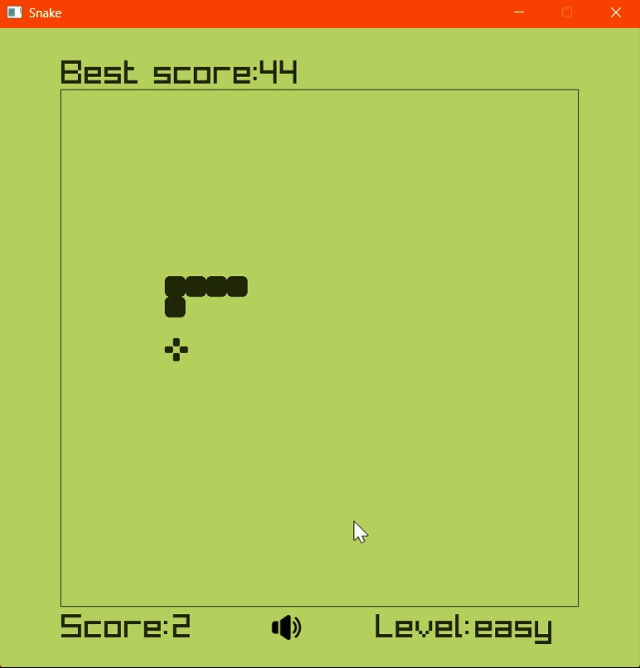

# Функциональное назначение программы

Простейшая игра "Змейка"

# Демонстрация работы

# Сборка и запуск

* Склонируйте или скачайте репозиторий.
* Запустите файл "snake.exe"

# Руководство

## Перемещение змейки
Используйте клавиши-стрелочки "влево", "вправо", "вниз", "вверх" для перемещения змейки.

## Отключение звука на панели, регулировка уровня сложности
Используйте ЛКМ для активации
